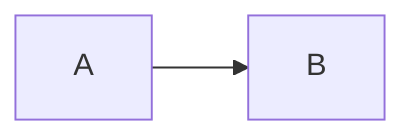

---
# Template for a new education package.
# Copy this file, rename it (e.g. "quantum-ml-patterns.md", no leading underscore),
# and fill in the fields. Files starting with "_" are NOT published by Jekyll.
title: "Topic, Explained Simply"
collection: education
permalink: /education/your-topic-slug
excerpt: "One sentence that makes people want to read this."
audience: "Who is this for?"
level: "Beginner | Intermediate | Advanced"
duration: "X minutes"
prerequisites: "What should readers already know?"
related_publication: /publication/your-publication-permalink
---

**For:** {{ page.audience }}  
**Level:** {{ page.level }} · **Time:** {{ page.duration }}  
**Prerequisites:** {{ page.prerequisites }}

## The idea in three sentences

1. ...
2. ...
3. ...

## An everyday analogy

Map each technical concept to something familiar.

## The picture

## A tiny worked example

The smallest example that still shows the key idea. Math works with $$...$$.

## Common misconceptions

- *"..."* Not quite: ...

## Check yourself

1. ...

Show answers

<ol>
<li>...</li>
</ol>

## Go further

- Related paper: [Title]({{ page.related_publication }})
