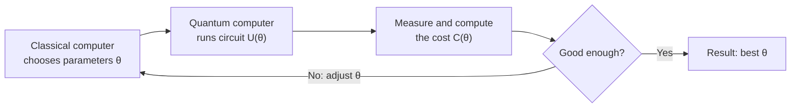

**For:** {{ page.audience }}  
**Level:** {{ page.level }} · **Time:** {{ page.duration }}  
**Prerequisites:** {{ page.prerequisites }}

## The idea in three sentences

1. A *variational quantum algorithm* (VQA) uses a quantum circuit with adjustable "knobs", called **parameters**.
2. The quantum computer runs the circuit and reports a single number, the **cost**, that says how good the current knob settings are.
3. A classical computer turns the knobs step by step to make the cost as small as possible. The best settings found are the answer.

## An everyday analogy: hiking downhill in the fog

Imagine you are on a mountain in thick fog and want to reach the lowest valley.

- **Where you stand** = the current parameter values.
- **Your altimeter** = the quantum computer: it tells you your current altitude (the cost), but not the shape of the whole mountain.
- **You, deciding where to step next** = the classical optimizer.
- **The mountain itself** = the *cost landscape*: the cost for every possible parameter setting.

You check your altitude, take a step, check again, and keep going downhill. VQAs work the same way.

## The loop at a glance

## A tiny worked example

Take a single qubit that starts in state $$\vert 0\rangle$$. Our circuit has one knob: a rotation $$R_Y(\theta)$$ by angle $$\theta$$. Our goal is to turn the qubit into $$\vert 1\rangle$$.

After the rotation, the qubit is in state

$$
R_Y(\theta)\vert 0\rangle = \cos\tfrac{\theta}{2}\,\vert 0\rangle + \sin\tfrac{\theta}{2}\,\vert 1\rangle .
$$

As the cost, we use the expected value of a $$Z$$ measurement (outcome $$+1$$ for 0, $$-1$$ for 1):

$$
C(\theta) = \cos^2\tfrac{\theta}{2} - \sin^2\tfrac{\theta}{2} = \cos\theta .
$$

| $$\theta$$ | $$0$$ | $$\pi/2$$ | $$\pi$$ |
|---|---|---|---|
| Cost $$C(\theta)$$ | $$+1$$ | $$0$$ | $$-1$$ (minimum) |
| Qubit is mostly… | 0 | 50/50 | 1 |

The optimizer starts somewhere, for example at $$\theta = 0.3$$, notices that the cost drops as $$\theta$$ grows, and walks downhill until it reaches $$\theta = \pi$$. There the qubit is exactly $$\vert 1\rangle$$. Real VQAs work the same way, just with many qubits and many knobs.

## Why the landscape matters

In the one-qubit example, the landscape is a smooth valley. Real cost landscapes can be much harder:

- **Local minima:** small valleys that look like the lowest point but are not.
- **Flat regions (barren plateaus):** areas so flat that the altimeter barely changes, so the optimizer cannot tell which way is downhill.
- **Noise:** real quantum hardware gives slightly different readings each time, as if the altimeter were shaky.

Visualizing and analyzing these landscapes helps to choose better circuits and optimizers. This is the topic of the related paper below.

## Common misconceptions

- *"The quantum computer does all the work."* No. In a VQA, the classical optimizer does a large part of the work.
- *"One run gives the answer."* No. The circuit is executed many times, both to estimate the cost and in each optimization step.

## Check yourself

1. In the hiking analogy, what role does the quantum computer play?
2. In the worked example, why is $$\theta = \pi$$ the best setting?

Show answers

<ol>
<li>It is the altimeter: it measures the cost for the current parameters.</li>
<li>Because the cost \(\cos\theta\) reaches its minimum of \(-1\) there, which means the qubit is in state \(\vert 1\rangle\).</li>
</ol>

## Go further

- Related paper: [Exploring the Cost Landscape of Variational Quantum Algorithms]({{ page.related_publication }}) (SummerSOC 2024)
- Try it yourself without code: model and run quantum algorithms visually with the Qonstruct low-code platform ([CLOSER 2026 paper](/publication/2026-01-01-low-code-quantum-algorithm-modeling-hybrid-cloud))
